# FlightMD walkthrough

A task-by-task guide for pilots and engineers: upload a log, read the report, change a parameter,
and check on the next flight that it helped. It follows the web app as it is now; the command
line equivalents are in [section 11](#11-the-same-from-the-command-line).

To try it without a log of your own, use the samples in `tests/sample_logs/`:
`sample_flawed.ulg` has an oscillation and a satellite drop, `sample_clean.ulg` has neither. They
are synthetic flights made for testing, not real recordings.

> **Screenshots.** The images below are generated from the running app by the walkthrough
> pipeline. To regenerate them, start FlightMD as in
> [`tools/walkthrough/README.md`](../tools/walkthrough/README.md) and run `npm run stills` (the
> same as `npm run walkthrough -- --stills`) in `tools/walkthrough`. It writes
> `docs/walkthrough/*.png` under the names used here.

## 1. Upload a log

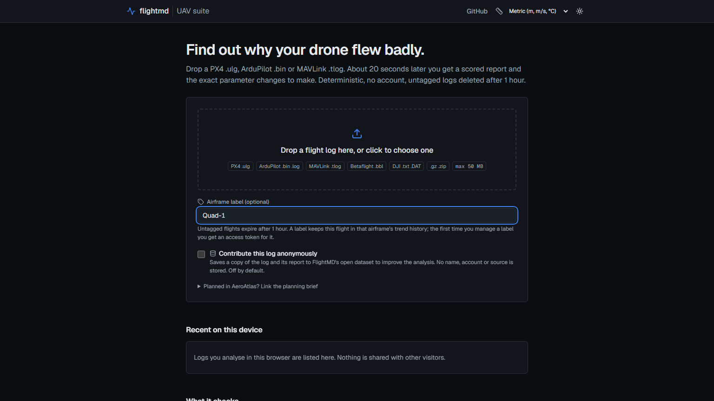

1. Open FlightMD's home page.
2. Optional: type an **Airframe label** (for example `Quad-1`) if you want this flight kept in that
   airframe's history. Without a label the report is deleted after an hour. See
   [section 4](#4-mark-changes-as-applied-and-verify-them) before you use a label for the first time.
3. Drop the log on the drop zone, or click it and pick the file.
   - **PX4** `.ulg`, **ArduPilot** `.bin` or text `.log`, **MAVLink telemetry** `.tlog`,
     **Betaflight/INAV** `.bbl`, `.bfl` or `LOG*.TXT`, **DJI** `DJIFlightRecord_*.txt`.
   - Any of them inside a `.gz`, or a `.zip` holding one log.
   - The format is read from the file's contents, so a renamed file still works.
   - DJI records v1–12 work offline. v13 and later are encrypted; see
     [Troubleshooting](#12-troubleshooting). DJI `.DAT` files are refused: there is no openly
     licensed decoder.
   - The size limit is shown on the drop zone (50 MB unless the server says otherwise).
4. Leave **Contribute this log anonymously** off unless you want to share it (see
   [Privacy](#10-privacy)).
5. Planned the flight in AeroAtlas? Open **Link the planning brief** and paste the brief's
   SHA-256, so the report points back to its planning evidence.

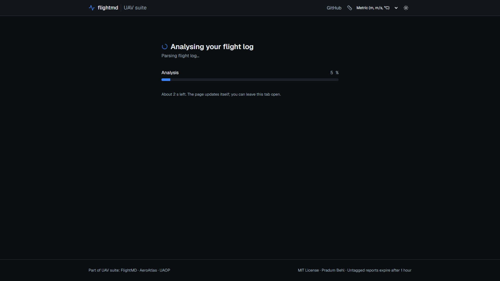

While the log is analysed you see **Analysing your flight log** with a progress bar and the
parser's own status. Once it can tell, it shows the time left ("About 12 s left"); until then it
says it usually takes about 20 seconds. You can leave the tab open: the page turns into the
report by itself.

- **Waiting for a free worker…** means other analyses are running first.
- A Betaflight log decodes slowly: a 5-minute 2 kHz log takes a minute or two.
- If the same file was uploaded in the last hour (with the same label), you get that report back
  straight away, with a note at the top saying so.
- After 10 minutes the page stops checking and says **Still not finished**. **Try again** resumes.

## 2. Read the report, top to bottom

The report is ordered the way you'd work: the verdict, what to fix, the parameter changes, the
evidence, then the details.


1. **Score and grade.** The ring shows a health score from 0 to 100 and a band (Excellent,
   Good, Caution, Warning, Critical); the letter grade is the same score on an A–F scale. The
   score is weighted across the checks that could actually run: oscillation, vibration and EKF
   20 % each, battery and GPS 15 % each, parameters and motors 5 % each.
2. **What was assessed.** The line under the summary says how many checks ran ("Assessed 6 of
   9 checks") and, when some couldn't, what share of the weighted score they carry. A check the
   log has no data for is listed as **Not assessed**. It is left out of the score, never counted
   as 100. If no check could run there is no score at all, and the ring says **Not assessed**.
3. **Severity counts.** The Critical and Warning badges jump to the findings. "No critical or
   warning findings" means every check that ran passed.
4. **Parser warnings**, if any, link to the flight details: parts of the log that were skipped
   or repaired.

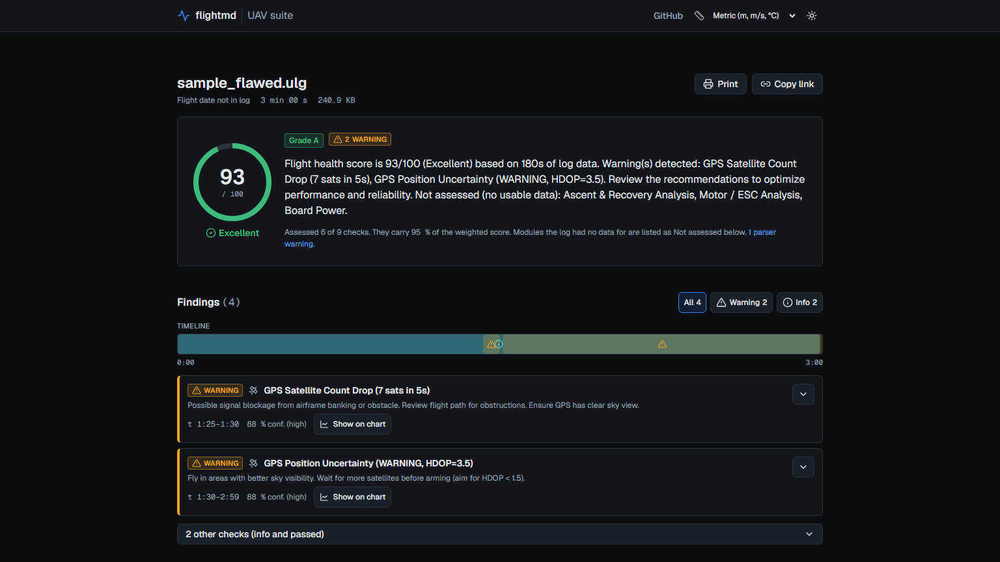

5. **Findings.** Critical and warning findings come first; info and passed checks are folded
   under "other checks". The pills at the top filter by severity.
6. **The timeline** runs from the start to the end of the log, one marker per finding at the time
   it happened. Click a marker to jump to its card. The grey band is when the vehicle was armed.
   Checks only look at the armed or in-air part of the flight, so GPS acquisition on the pad or
   motors spinning down after landing aren't reported as faults. A log without arming data is
   checked as a whole, and the report says so.
7. **A finding card** shows the time window (`t 1:12–1:40`) and the **confidence**: a percentage
   and a level (high, medium, low) from how long the problem lasted, how far past the threshold it
   went and how good the data was. Open the card for **What to do**, **What happened** and the
   **Technical detail**, plus the parameters it touches.

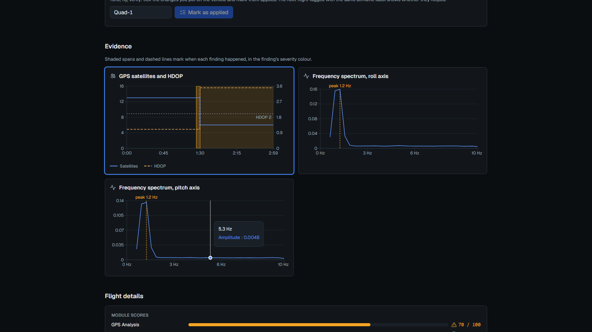

8. **Show on chart** scrolls to the chart behind the finding. The finding's time window is shaded
   in its severity colour and the chart gets a blue ring. The same window is highlighted on the
   flight path map ("Blue band: the selected finding").
9. Further down: **Evidence** (all charts), **Flight details** (module scores, firmware, modes,
   log format, the log's SHA-256), and the **Flight path** as a map or in 3D, coloured by wind or
   GPS HDOP if you like.

## 3. Use the parameter sheet

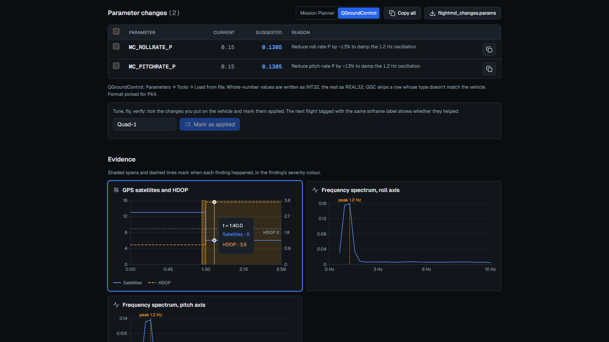

1. Under **Parameter changes** each row has the parameter, its current value in the log, the
   suggested value and the reason.
2. Pick the format with the toggle. FlightMD picks one for the autopilot it detected (PX4 →
   QGroundControl, ArduPilot → Mission Planner), but you can switch.
   - **Mission Planner:** `NAME,VALUE` lines. Config → Full Parameter List → Load from file, then
     Write Params.
   - **QGroundControl:** a tab-separated file with QGC's header. Parameters → Tools → Load from
     file. Whole numbers are written as INT32 and the rest as REAL32; QGC skips a row whose type
     doesn't match the vehicle's, so check that every row was applied.
3. **Copy all** copies the whole sheet; the copy button on a row copies that one parameter. The
   download button saves `flightmd_changes.param` (Mission Planner) or `flightmd_changes.params`
   (QGroundControl).

Before you write anything to the vehicle:

- Save the vehicle's current parameters first, so you can go back.
- Check that the log came from this vehicle and this firmware, and that the **Current** column
  matches what's on the vehicle now. If someone changed it since, the suggestion may not fit.
- Read the reason on each row. Suggestions are a starting point from one flight, not a tune.
- Change one thing (or one related group) at a time, so the next flight tells you what helped.
- Test-fly in a safe place, ready to take over manually.

## 4. Mark changes as applied and verify them

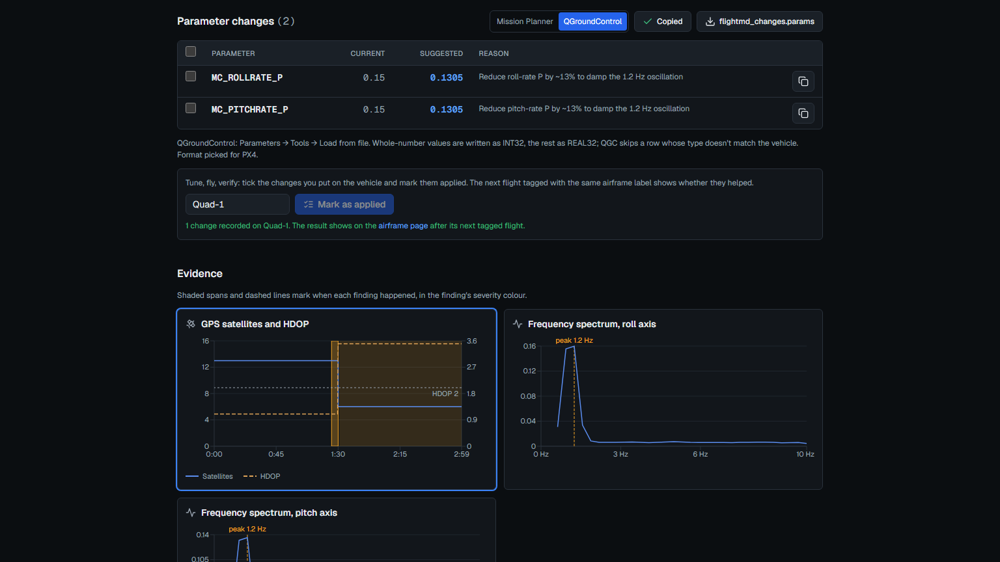

1. Upload the flight with an **airframe label** (section 1). The first time a label is used it is
   *claimed*: the server creates an **access token** for it and your browser saves it.
2. After you've put a change on the vehicle, open that flight's report, tick the parameters you
   changed in the sheet, check the label in the box next to the button and click **Mark N
   changes as applied**. The confirmation says the change was recorded on that airframe.
3. Fly again and upload the next log **with the same label**.
4. Open the airframe page (the label is a link in **Recent on this device** on the home page, and
   in the confirmation), at `/airframe/<label>`.

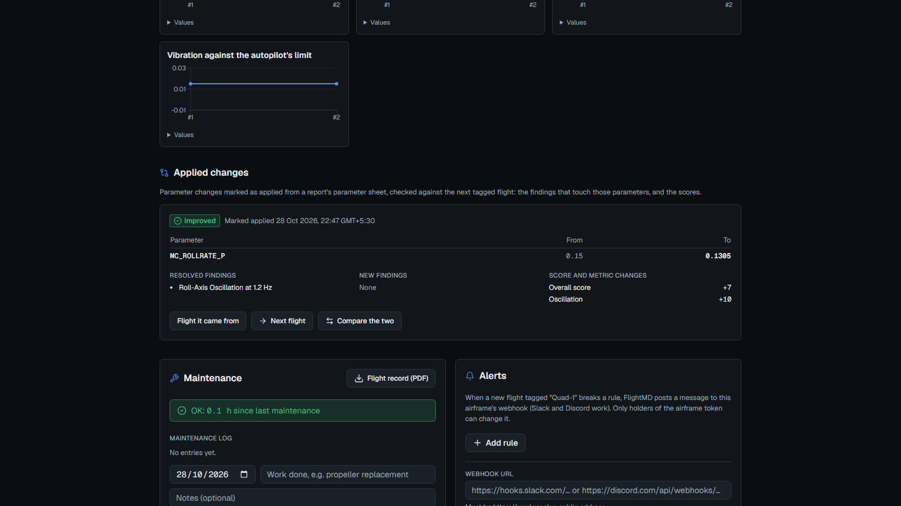

5. Under **Applied changes** each change shows a status: **Pending** until a later tagged flight
   exists, then **Improved**, **Unchanged**, **Worse** or **Mixed**. Below it are the findings
   that went away, the new ones, and how the scores and metrics moved. **Compare the two** opens
   both flights side by side.

**Keep the token safe.** Anyone with it can read the airframe's history and change its
maintenance log, alerts and webhook; without it, nobody can. The airframe page shows "Access
token saved in this browser" with buttons to show, copy and forget it. Copy it somewhere safe:

- **On another device or browser**, open `/airframe/<label>`, paste it into **Access token** and
  click **Use token**.
- **If it's lost**, it can't be recovered: the server keeps only a hash. Use a new label.
- Uploading with a claimed label from a browser that doesn't have its token is refused, with a
  link to the airframe page. Add the token there first, then upload again.

## 5. Watch trends and keep a maintenance log

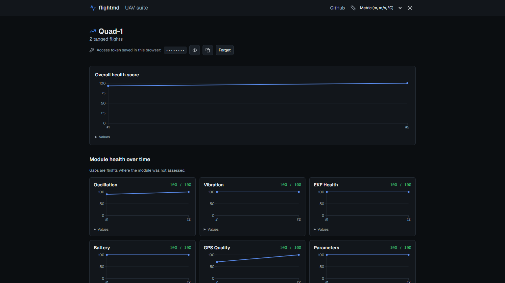

On the airframe page:

1. **Overall health score** plots every tagged flight, oldest first. **Module health over time**
   has one chart per check; a gap means that check wasn't assessed on that flight. **Raw metrics
   over time** shows the numbers behind the scores, where a slow drift shows before a finding
   fires.
2. **Maintenance:** set the **Service interval (flight hours)** to see when service is due, add
   entries to the **Maintenance log**, keep a **Pre-flight checklist**, and download the
   **Flight record (PDF)**.
3. **Alerts:** add rules (a score or metric above or below a threshold) and an https **Webhook URL**
   (Slack and Discord work). When a new tagged flight breaks a rule, FlightMD posts to the webhook.
   The URL must reach a public address.
4. **Flight history** lists every tagged flight; tick two to compare them.

## 6. Compare two flights

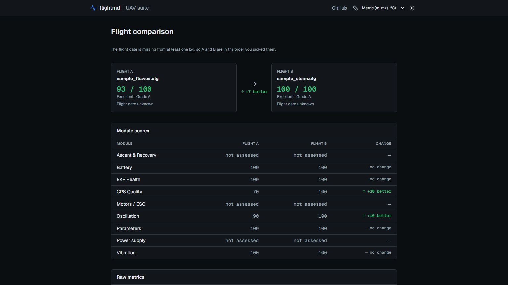

1. Pick the flights: tick two in **Recent on this device** on the home page and click **Compare
   selected**, tick two in the airframe page's **Flight history**, or click **Compare the two** on
   an applied change.
2. The earlier flight is always on the left, whatever order you ticked them in. If a log has no
   flight date, they stay in the order you picked and the page says so.
3. Read **Module scores** (with the change per check), **Raw metrics** (no colours there: for HDOP or
   vibration, higher isn't better), then **Resolved** and **New** findings and the checks that are
   **Still present**.
4. A warning at the top means the flights come from different vehicles or autopilots, so the
   scores aren't directly comparable.

## 7. Export, print and share


1. At the bottom of the report, under **Export**:
   - **PDF**: a printable record. If the server can't render PDFs, the print dialog opens
     instead; choose "Save as PDF" there.
   - **JSON**: the full report, in the published schema (`docs/schema/`).
   - **GPX** (the track with timestamps) and **KML** (for Google Earth, with HDOP and wind per
     point), when the log has GPS positions.
2. **Print** at the top of the report prints the page itself. The print layout is the report:
   light, with every finding opened and the buttons left out.

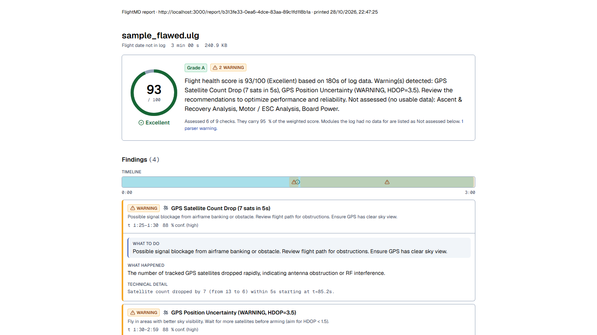

3. **Copy link** copies the report's address. It works for an hour, or for as long as the
   airframe keeps it when the flight is tagged.

## 8. Ask about the report

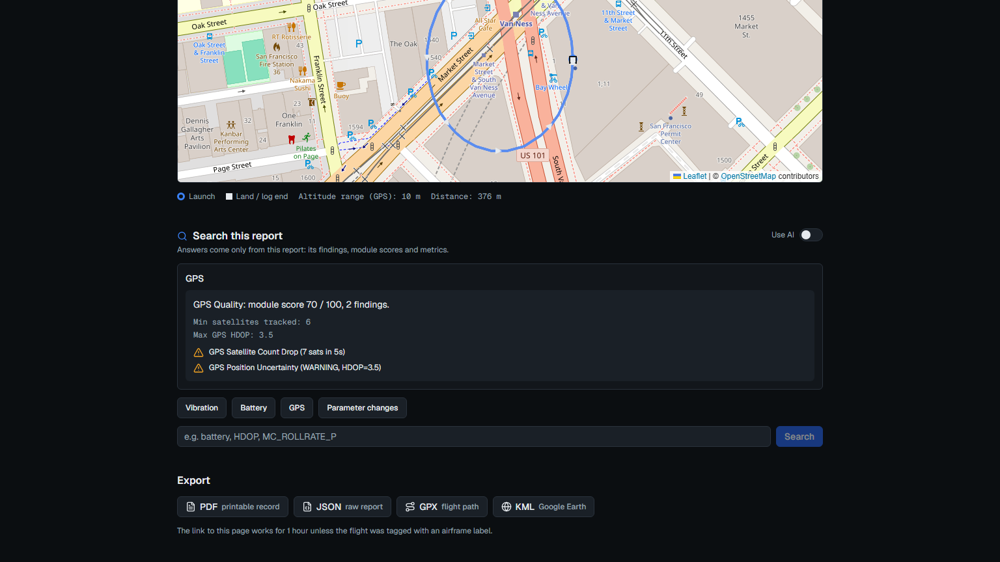

1. **Search this report** answers from this report only: its findings, module scores and
   metrics. Click a preset (Vibration, Battery, GPS, Parameter changes) or type a check name, a
   parameter (`MC_ROLLRATE_P`) or a word from the findings.
2. Answers link to the findings they come from. If nothing matches, it says so; it doesn't guess.
3. When the server has an AI key, **Use AI** switches to written answers. The AI is told to use
   this report only, but check what it says against the findings. Without a key, the first
   question falls back to the built-in search and the switch turns itself off; that's expected.
4. Limits: 500 characters per question, and a per-hour cap ("Too many questions for now"). The
   box never sees the raw log.

## 9. Units and themes

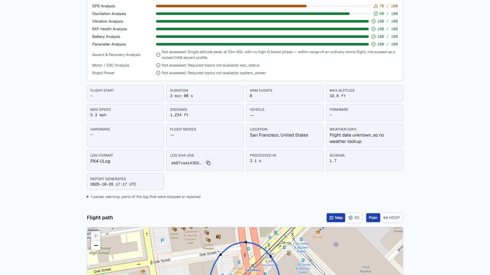

1. The **Units** menu in the header switches between Metric (m, m/s, °C), Imperial (ft, mph, °F)
   and Aviation (ft, kt, °C). Altitude, speed, distance and temperature follow it everywhere.
2. The sun/moon button switches between the dark "ops" theme and the light "field" theme, for a
   laptop in sunlight. Printing is always light.
3. Both choices are saved in this browser.

## 10. Privacy

- A report is reachable only through its random link. There is no public list of uploads.
- **Untagged reports are deleted an hour after upload.** A tagged flight is kept for its airframe's
  history, which only the token holder can open.
- **Recent on this device** on the home page is stored in your browser only. Remove one entry with
  its × button, or all with **Clear list**.
- **Contribute this log anonymously** is off by default. If you tick it, the raw log is kept with
  a copy of the report stripped of the file name, place name and GPS track. The raw log itself
  still contains its GPS data. To take it back, click **Withdraw contribution** next to the flight
  in **Recent on this device** (or call `DELETE /dataset/{contribution_id}` with the id the upload
  returned). That deletes both.
- The Q&A sees the report, never the raw log.
- A server run with `FLIGHTMD_OFFLINE=1` makes no outside requests: no weather, place names, AI
  or DJI keys.

## 11. The same from the command line

Install the engine (`pip install .` in the repo; add `[pdf]` for PDF output), then:

```bash
flightmd analyse flight.ulg --json report.json --pdf report.pdf --gpx track.gpx --kml track.kml
flightmd compare before.json after.json
```

- `analyse` prints the score, grade and every finding, and writes the files you ask for. It runs
  offline unless you add `--online` (weather and place names). It exits with 1 when the log can't
  be analysed, 2 when the file doesn't exist, and 3 when everything but the PDF was written
  (WeasyPrint missing).
- `compare` takes two report JSON files, before then after, and prints the score change, the
  module changes and the resolved and new findings.

## 12. Troubleshooting

| You see | Why | What to do |
|---|---|---|
| "Unsupported file…" or "Unrecognized log format" | The file isn't one of the formats in section 1 | Upload the original log from the autopilot or ground station |
| "File too large…" | Over the upload limit | Trim the log, or zip it (the limit applies to the upload; the unpacked log has its own, larger limit) |
| "Analysis failed" with a reason | The API couldn't analyse it (it answers 422 for the report). The reason says why: | |
| … "No analysable telemetry in this log" | No IMU, GPS, battery or ESC data, e.g. a params-only tlog | Upload the onboard log rather than a short telemetry capture |
| … "Parsing the log took longer than N s" | Very long or very dense log | Split it, or raise `FLIGHTMD_PARSE_TIMEOUT_S` on your own server |
| … "Log is N MB; the limit is M MB." | Bigger than `FLIGHTMD_MAX_LOG_MB` once unpacked | Raise the limit on your own server |
| … "DJI log v13+ needs DJI_API_KEY…" | Newer DJI records are encrypted | On your own server: install the `dji` extra, set `DJI_API_KEY` (a DJI developer app key) and leave `FLIGHTMD_OFFLINE` unset. The key exchange goes to DJI's servers |
| … "This is a DJI aircraft .DAT log…" | `.DAT` isn't supported | Upload the app's `DJIFlightRecord_*.txt` instead |
| "Server busy, try again in a minute." | Too many analyses queued (503) | Wait a minute and upload again |
| "Upload limit reached. Try again later." | Per-hour upload limit for your address (429) | Wait, or raise `RATE_LIMIT_PER_HOUR` on your own server |
| "Network error. Is the API running?" | The page can't reach the API | Check the API is up and that `NEXT_PUBLIC_API_URL` and `CORS_ORIGINS` match |
| "Report expired" | Untagged reports are deleted after an hour | Upload the log again; tag it to keep it |
| "The server restarted during the analysis." | The API restarted mid-analysis | Upload the log again |
| A check says **Not assessed** | The log has no data for it (no ESC telemetry for motors, no GPS indoors) | Nothing is wrong with the flight; the score is from the other checks. Log that data next time if you want it checked |
| **Not assessed** instead of a score | None of the checks could run | See the flight details and parser warnings for what was missing |
| "This airframe needs its access token" or "That access token doesn't match" | The label is claimed and this browser has no token for it, or a wrong one | Paste the right token on the airframe page (section 4) |
| "This server can't render PDFs…" | No WeasyPrint on the server | Use "Save as PDF" in the print dialog that opened |
